# 사업계획 재무모델 스킬 (Claude Code용) — 한국어 무료 공개판

회사의 실적 자료를 AI에게 주면 내년 사업계획 재무모델을 Excel로 만들어 주는 스킬입니다.
한국 기업의 재무 담당자를 위해 만들었습니다.

만든 사람은 경력 15년의 한국공인회계사입니다.
SOC, PF, Valuation 등 여러 분야에서 기업가치평가 모델과 차입금 상환 가능성 모델을 만들어 왔습니다.

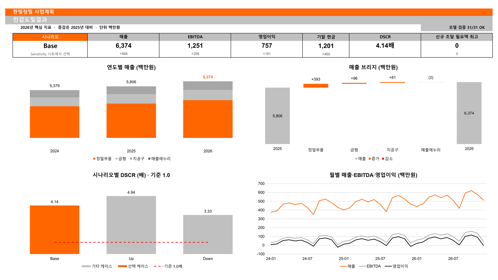

## 무엇이 다른가

### 1. 차입금과 투자가 세 재무제표에 모두 연결됩니다

월별 재무상태표를 함께 넣으면 차입금과 유형자산 투자가 손익계산서, 재무상태표, 현금흐름표에 모두 반영됩니다.

- **차입금**: 약정별 잔액, 금리, 만기와 상환 일정을 넣으면 월별 상환액, 이자, 잔액을 계산합니다. 이자는 손익계산서에, 차입금 잔액은 재무상태표에, 원금 상환과 신규 조달은 현금흐름표에 반영됩니다. 상환 일정이 없으면 만기에 한 번에 상환하는 것으로 보고, 만기가 온 약정을 상환할지 연장할지는 약정별로 정할 수 있습니다.
- **유형자산 투자(Capex)**: 투자 계획을 넣으면 월별 취득과 감가상각을 계산합니다. 감가상각비는 손익계산서에, 유형자산 잔액은 재무상태표에, 취득 지출은 현금흐름표에 반영됩니다.

### 2. 넣은 자료만큼 모델이 정교해집니다

정해진 틀에 숫자를 채우는 방식이 아닙니다. 자료의 수준에 따라 모델의 구성이 달라집니다.

꼭 필요한 자료는 하나입니다. 최소 12개월의 계정별 월별 손익계산서, 또는 손익을 집계할 수 있는 분개장이나 총계정원장입니다. 나머지는 있는 만큼 넣으면 됩니다.

| 넣은 자료 | 모델에서 달라지는 것 |
|---|---|
| 월별 손익계산서만 | 손익과 현금흐름 중심의 모델 |
| 분개장 | 손익을 직접 집계하고, 거래처 정보가 있으면 매출 집중도와 반복 거래를 분석해 매출 추정에 활용 |
| 월별 재무상태표 | 재무상태표와 운전자본(회전일수) 추정 추가 |
| 품목별 월 판매 수량과 단가 | 수량과 단가를 따로 조정하는 매출 추정 |
| 차입금 약정 명세와 상환 일정 | 약정별 상환·이자·조달 계산 |
| 고정자산대장, 유형자산 투자 계획 | 자산군별 감가상각과 월별 취득 지출 |
| 직군별 인원과 급여 | 인원 기준 인건비 |
| 세무조정계산서 | 이월결손금, 세무조정, 세액공제를 반영한 법인세 |

보조 자료가 없는 부분은 가정으로 대신하고, 적용한 가정과 확인할 사항을 결과 요약에 적습니다.

### 3. 회사의 장부를 읽고 매출·비용의 추정 방식을 먼저 제안합니다

같은 업종이라도 매출과 비용이 장부에 잡히는 모습은 회사마다 다릅니다. 이 스킬은 회사가 적용하는 회계기준(K-IFRS 또는 일반기업회계기준)에 따라 장부에 기록한 월별 매출과 비용을 출발점으로 삼습니다. 분개장이 있으면 거래처별 금액과 거래가 반복되는 기간도 살펴봅니다. AI는 이 실적을 판매 수량이나 계약 내역과 대조해, 매출·비용 항목별 추정 방식과 그 근거를 먼저 제안합니다. 재무 담당자가 추정 구조를 처음부터 짤 필요가 없습니다.

| 실적과 보조 자료에서 확인한 특징 | 제안하는 추정 방식 |
|---|---|
| 규격품을 반복 판매하고 품목별 수량·단가 자료가 있다 | 월별 판매 수량 × 단가 |
| 거래처별 월 매출이 일정 기간 이어지고 계약 기간·금액을 확인할 수 있다 | 계약별 월 매출에 갱신분과 예상 신규 수주분 반영 |
| 많은 고객에게 비슷한 금액의 매출이 매달 반복된다 | 신규 유입과 이탈을 반영한 고객 수 × 월 객단가 |
| 특정 매출 항목 대비 비용 비율이 달마다 안정적이다 | 해당 매출액 × 비용률 |
| 월별 금액이 일정한 비용 | 기준 월 비용에 연 인상률 적용 |
| 기본료가 있고 변동분이 특정 매출에 비례하는 비용 | 고정액 + 해당 매출액 × 비용률 |

재무 담당자는 제안을 확인하고, 계약 갱신률이나 임금 인상률처럼 장부만으로 정할 수 없는 가정을 정합니다. 모델을 만든 뒤에는 마지막 실적 월과 첫 추정 월 사이에 설명되지 않는 단절이 없는지 확인합니다.

개별 거래의 인식 시점과 회계기준 적합성은 판정하지 않습니다. 이 판단은 회사의 몫입니다.

### 4. Base·Up·Down 외에 비교 케이스를 최대 7개까지 추가할 수 있습니다

- 기본 시나리오 세 가지(Base, Up, Down)에 케이스를 더해 여러 민감도를 분석할 수 있습니다.
- 케이스마다 매출·비용 항목별 배수와 매월 더하는 가산액을 정할 수 있습니다. 수량, 단가, 계약 갱신 확률 같은 항목 내부의 동인은 기본 시나리오별로 바꿀 수 있습니다.
- `Sensitivity` 시트에서 케이스를 고르면 그 가정을 쓰는 추정치가 모두 바뀝니다. 가정을 고친 뒤 `민감도 갱신` 단추를 누르면 케이스별 결과 비교표가 다시 계산됩니다.

### 5. Excel 모델의 수식은 AI가 아니라 정해진 엔진이 조립합니다

AI는 원자료를 정리하고 추정 방식을 설계하며, 검증 결과와 주요 가정을 요약합니다. 수식은 엔진이 조립하고, 별도 검증이 실적과 맞는지 대사합니다.

- **살아 있는 모델**: 수식이 그대로 남아 있어, 노란 칸의 가정을 바꾸면 결과가 따라 움직입니다.
- **근거가 보이는 가정**: 주요 가정 옆에서 출처나 산정 근거를 확인할 수 있습니다.
- **내장 검증**: 재무제표가 맞는지, 실적과 일치하는지 모델이 스스로 확인합니다.
- **구조도**: 아래에서 따로 설명합니다.

## 구조도: 회사의 기초 자료가 어디에 반영되는지 보는 화면

모델과 함께 구조도(`.html`)가 만들어집니다. 브라우저로 여는 한 장짜리 화면이고, 인터넷 연결 없이 열립니다. 회사가 넣은 기초 자료와 가정이 어떤 시트를 거쳐 재무제표와 결과에 닿는지를 선으로 보여 줍니다. 수식을 하나씩 따라가지 않고도 자료와 시트의 연결을 확인할 수 있습니다.

항목을 누르면 길이 켜지는 모습은 [약 47초 영상](docs/sheet_flow_ko.mp4)에서 볼 수 있습니다(소리 없음). 기초 자료가 모델에 반영되는 과정도 함께 나옵니다.

### 화면 구성 (한빛정밀 예시)

왼쪽부터 입력, 계산 세 단계, 산출 순서로 다섯 단계입니다.

| 단계 | 들어 있는 것 |
|---|---|
| 입력 | 사용자가 정하는 가정 묶음(기준, 자금, 운전자본, 법인세, 투자·상각, 인건비, 매출 가정, 비용 가정, 시나리오)과 회사의 실적 원자료(실적_IS, 실적_BS, 실적_차입) |
| 계산 ① 가정·기준 | 케이스 선택(Sensitivity), 전제사항, 금융조건, 월 축 |
| 계산 ② 동인별 상세 | 매출 항목별 계산, 인건비 |
| 계산 ③ 본표 집계 | 투자비, 재원조달, 운영수입, 운영비용, BS명세 |
| 산출 | 결과(민감도및결과), 재무제표(IS, BS, CF), 검증 |

### 읽는 법

- **항목을 누르면 길이 표시됩니다.** 진한 주황색은 선택한 항목, 연한 주황색은 값이 흘러가는 곳, 파란색은 값을 받아 오는 곳입니다.
- **위쪽 설명 칸**에 선택한 항목의 "바로 넘기는 곳", "닿는 산출", "받아 오는 곳"이 글로 정리됩니다. 입력 묶음을 누르면 그 안의 가정과 모델을 저장했을 때의 값도 함께 나옵니다.
- **"최종 산출까지"**는 그 시트 너머의 계산을 따라가 닿는 결과까지 보여 줍니다. **"직접 연결만"**은 선택한 항목과 직접 연결된 시트만 보여 줍니다.
- 점선은 뒤 단계에서 앞 단계로 되돌아가는 참조입니다.

### 예 1. 차입금 자료는 어디에 반영되는가

아래는 `재원조달` 시트를 누른 화면입니다. 파란색으로 표시된 것이 이 시트가 받아 오는 자료입니다. 회사의 차입금 약정 명세(`실적_차입`)와 재무상태표(`실적_BS`), 자금 가정이 들어옵니다. 주황색은 계산 결과가 가는 곳입니다. 이자와 상환·조달이 IS, CF, 결과 화면, 검증에 닿고, 차입금 잔액은 BS명세를 거쳐 BS에 닿습니다.

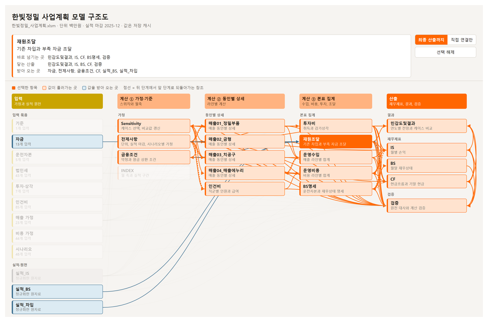

### 예 2. 유형자산 투자는 어디에 반영되는가

아래는 `투자비` 시트를 누른 화면입니다. 투자·상각 가정과 실적 자료(`실적_IS`, `실적_BS`)를 받아 취득과 감가상각을 계산합니다. 감가상각비는 운영비용과 IS로, 취득 지출은 CF로, 자산 잔액은 BS명세를 거쳐 BS로 넘어갑니다.

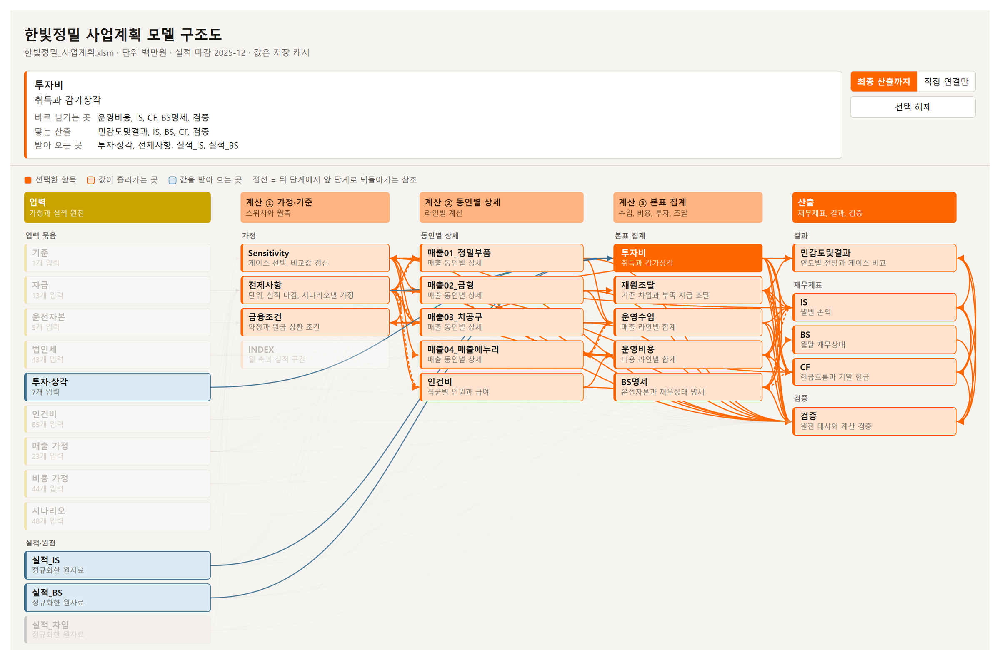

### 이런 때 씁니다

- 가정 하나를 바꾸기 전에, 어떤 결과가 영향을 받는지 미리 볼 때
- 결과 숫자가 이상할 때, 어느 자료와 시트에서 온 값인지 거슬러 올라갈 때
- 모델을 처음 받는 사람(경영진, 감사인, 대주단)에게 구조를 설명할 때

## 무엇이 나오는가

| 산출물 | 내용 |
|---|---|
| Excel 모델(`.xlsm`) | 월별 손익계산서·현금흐름표와 재무상태표(월별 재무상태표 자료가 있을 때), 차입 약정별 상환·연장, 현금 부족분 조달, 법인세(세율표, 이월결손금, 최저한세, 중간예납, 법인지방소득세), Base/Up/Down, 민감도, 검증 |
| 모델 구조도(`.html`) | 입력 → 계산 → 산출 흐름을 보여 주는 화면 |
| 결과 요약(`.md`) | 결과 숫자, 주요 가정과 근거, 확인이 필요한 사항 |

## 화면

아래 화면은 모두 가상 회사(한빛정밀)의 예시입니다. 손익계산서와 재무상태표, 판매 수량, 직군별 인원·급여, 설비투자 계획, 차입금 상환 일정을 넣어 만든 모델입니다.

| 목차 | 전제사항 |
|---|---|
| 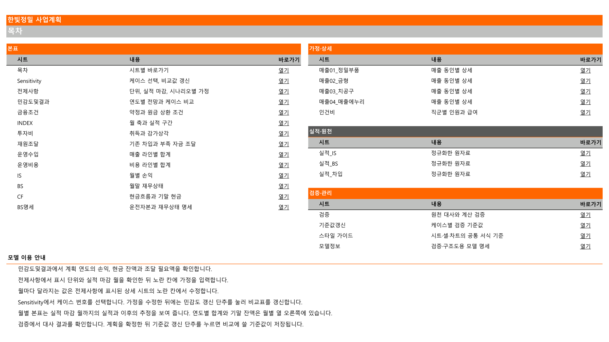 | 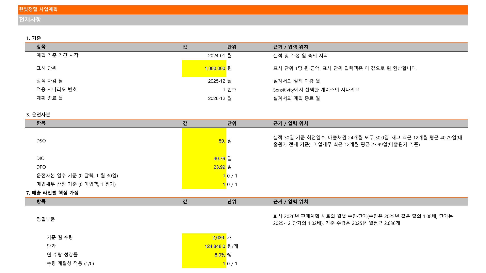 |

| 시나리오 비교 | 월별 손익 |
|---|---|
| 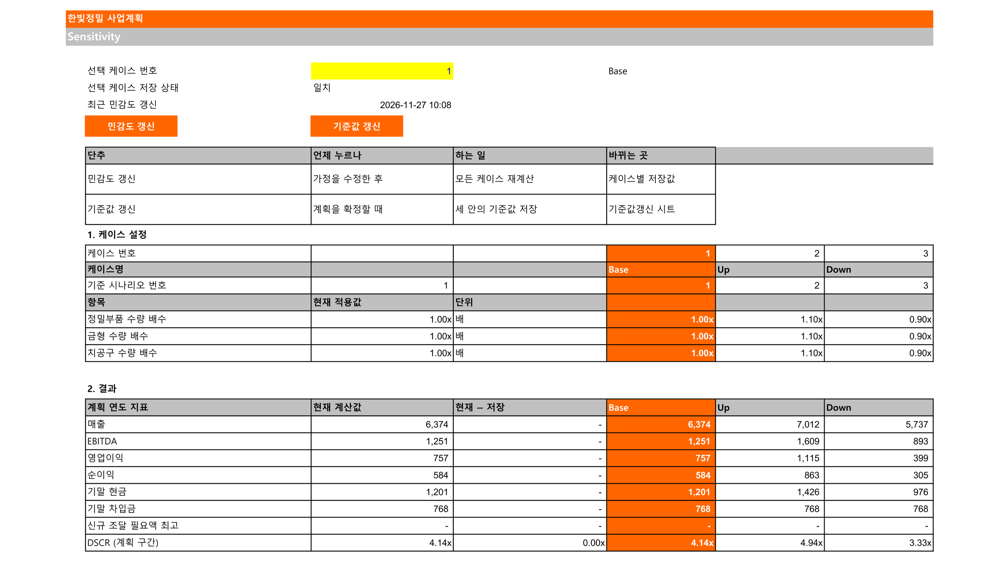 | 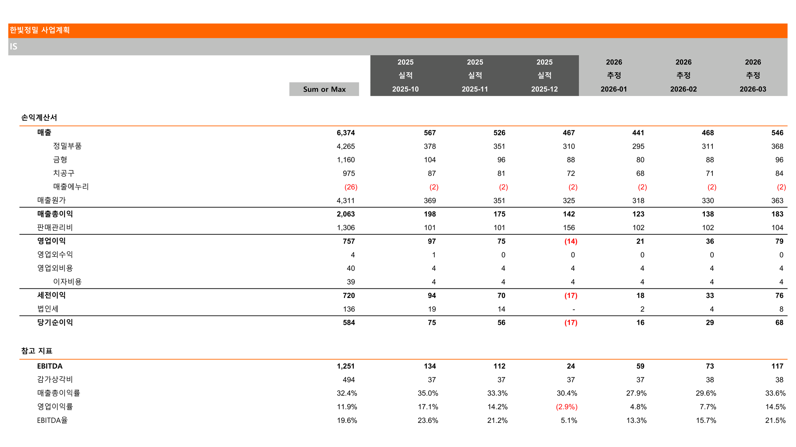 |

| 검증 | 구조도 |
|---|---|
| 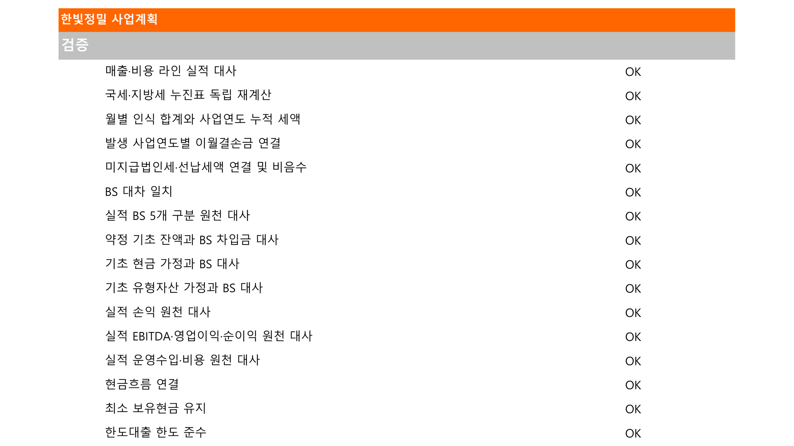 | 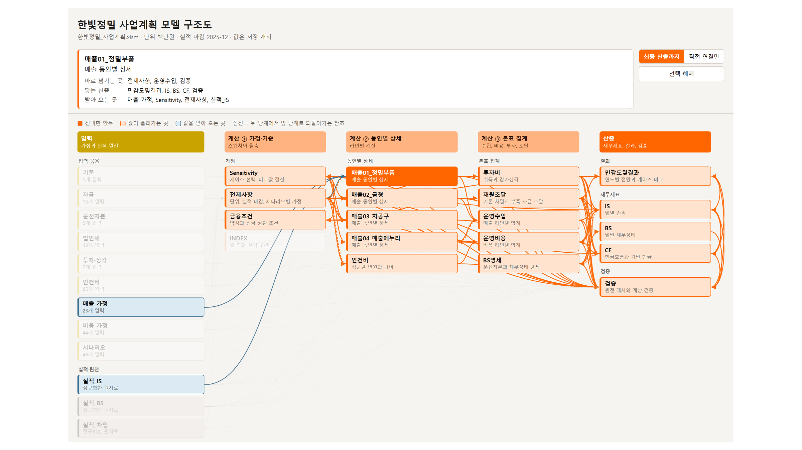 |

| 인건비 (직군별 인원 × 급여) | 투자비 (취득과 감가상각) |
|---|---|
| 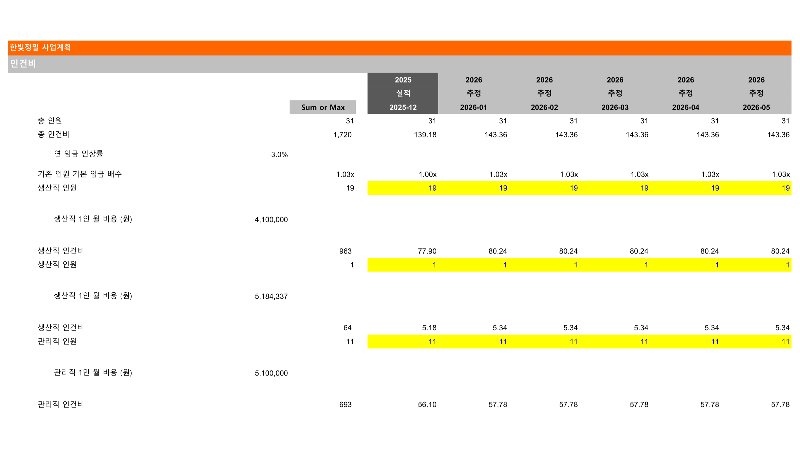 | 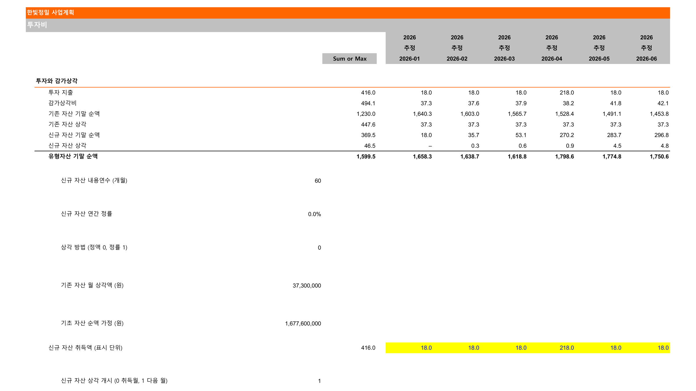 |

| 재원조달 (약정별 상환 일정과 이자) |
|---|
| 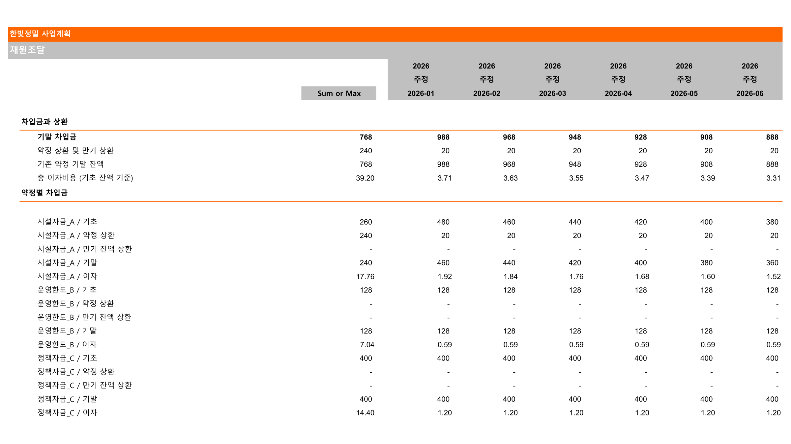 |

## 필요한 환경

- Windows PC, Microsoft Excel(데스크톱 설치본)
- Python 3.10 이상, 패키지 두 개: `pip install pywin32 openpyxl`
- Claude Code. 파일을 읽고 명령을 실행할 수 있는 다른 AI 코딩 도구에서도 쓸 수 있습니다. 그때는 "복사한 폴더의 `SKILL.md`를 읽고 절차대로 진행해 줘"라고 하면 됩니다.

## 설치와 사용

1. 이 저장소를 내려받아 압축을 풉니다(Code → Download ZIP).
2. 압축을 푼 폴더 안의 `bizplan-model` 폴더를 `사용자 폴더\.claude\skills\` 아래에 복사합니다.
3. 빈 작업 폴더에서 Claude Code를 열고 "내년 사업계획 모델을 만들어 줘"라고 합니다.
4. AI가 알려 주는 자료를 `Input` 폴더에 넣고, 가정에 대한 질문에 답합니다.
5. 모델, 구조도, 요약이 `Output` 폴더에 생깁니다.
6. 모델을 열 때 매크로 실행을 허용합니다. 가정을 고친 뒤에는 `민감도 갱신` 단추를 눌러 케이스별 비교표를 갱신합니다.

자세한 설명은 [`bizplan-model/README.md`](bizplan-model/README.md)에 있습니다.

## 알아 두실 점

- 계획 수립을 돕는 도구입니다. 세무·회계 자문이 아니며, 결과는 직접 검토하셔야 합니다.
- 스크립트는 인터넷에 접속하지 않고 PC 안에서만 동작합니다. 다만 자료를 읽는 것은 사용하는 AI 도구이므로, 회사가 재무 자료 처리를 승인한 도구에서만 쓰십시오.
- 법인세는 대한민국 법인세법·지방세법 기준(2026년 11월 확인)으로 계산합니다.
- 무료로 쓸 수 있습니다. 이 스킬로 만든 모델을 고객에게 유상으로 제공해도 됩니다. 스킬 자체나 수정본을 돈을 받고 팔거나 유료 상품·서비스에 넣는 것은 안 됩니다. 개별 지원은 없습니다. 조건은 [`LICENSE.md`](bizplan-model/LICENSE.md)에 있습니다.
